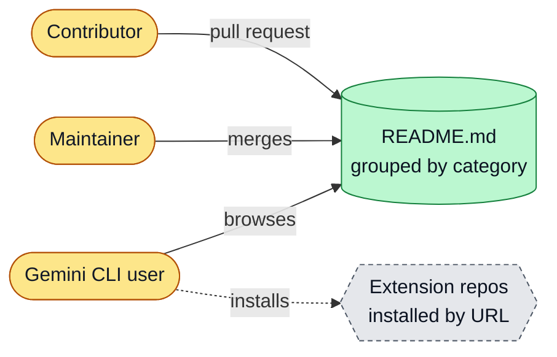
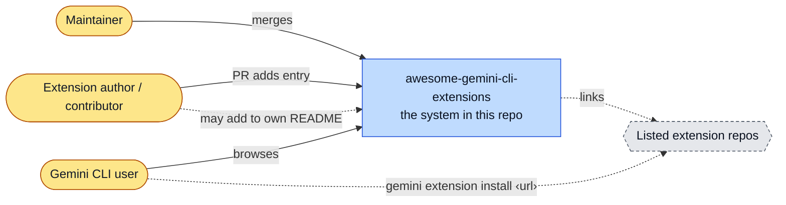
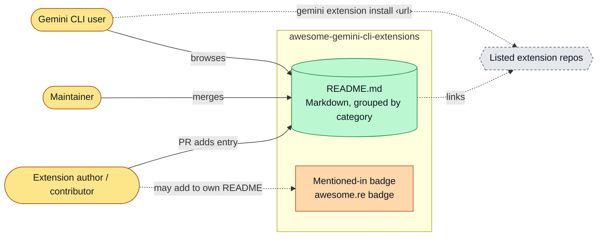
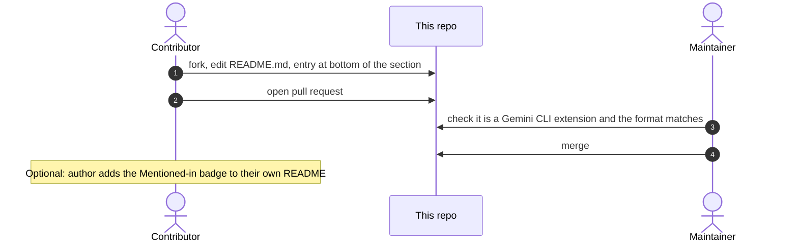
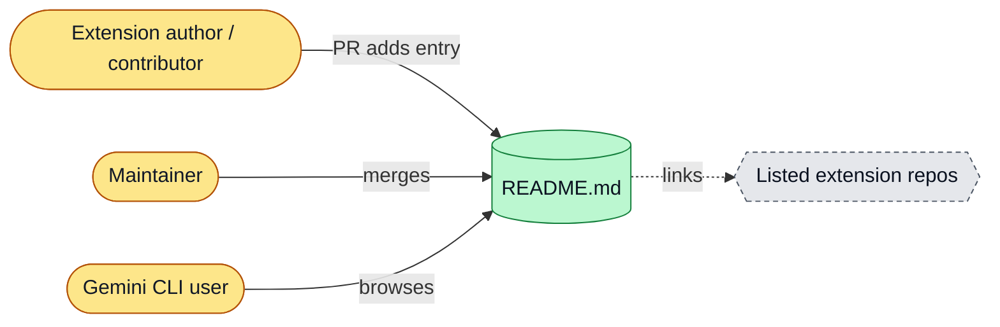

# awesome-gemini-cli-extensions: architecture

<!-- arch-kit:generated -->

> Whiteboard-level structure: what systems exist, what they talk to, and when they run. Evidence-backed; every box below maps to a path listed in [Evidence](#10-evidence).
> Generated by the ArchDocs kit from repo commit `61c94566c5`. Diagram sources: [`architecture/*.mmd`](architecture/). Hi-res renders sit next to each source.

## 1. Purpose

This repository is a fork of a curated list of Gemini CLI extensions: Git repositories that bundle prompts, GEMINI.md files, commands and themes and install with `gemini extension install <url>`. It has no code and no automation. The product is `README.md`, grouped by category. Contributors add an entry at the bottom of the right section by pull request.

## 2. Whiteboard view

Five boxes. There is no runtime: the list is the system.

Hi-res: [SVG](architecture/whiteboard.svg) · [PNG 3x](architecture/whiteboard@3x.png) · [dark SVG](architecture/whiteboard.dark.svg) · [dark PNG 3x](architecture/whiteboard.dark@3x.png)

Explorable version (Archify, standalone HTML, download and open locally): [`architecture/awesome-gemini-cli-extensions.archify.html`](architecture/awesome-gemini-cli-extensions.archify.html)

## 3. System context (C4 level 1)

Who and what touches the system from outside.

Hi-res: [SVG](architecture/context.svg) · [PNG 3x](architecture/context@3x.png)

## 4. Containers and components (C4 level 2)

The parts that run or hold data inside the repo's system boundary.

Hi-res: [SVG](architecture/containers.svg) · [PNG 3x](architecture/containers@3x.png)

| Container | Kind | Tech | What it does | Evidence |
|---|---|---|---|---|
| README.md | store | Markdown, grouped by category | Entry format: - [**Project Name**](URL) - Description. New entries go at the bottom of a section. | [`README.md#L7-L25`](../README.md#L7-L25), [`CONTRIBUTING.md#L7-L13`](../CONTRIBUTING.md#L7-L13) |
| Mentioned-in badge | doc | awesome.re badge | Optional badge an extension adds to its own README after being listed. | [`CONTRIBUTING.md#L15-L26`](../CONTRIBUTING.md#L15-L26) |

## 5. Key runtime sequences

### 5.1 Adding an extension

Hi-res: [SVG](architecture/sequence-1.svg) · [PNG 3x](architecture/sequence-1@3x.png)

## 6. Data flow and stores

How data moves between components and where it rests.

Hi-res: [SVG](architecture/dataflow.svg) · [PNG 3x](architecture/dataflow@3x.png)

## 7. Deployment and runtime topology

Nothing is deployed. GitHub renders `README.md` from the default branch. There is no CI, no schedule and no link checker.

## 8. Failure modes and how to see them

| Failure | What the user sees | How to see it | Evidence |
|---|---|---|---|
| Listed extension repo is removed or renamed | Dead link in the list | Reader report or manual check; no automation | [`README.md#L22-L25`](../README.md#L22-L25) |
| Entry does not follow the format | Inconsistent list | Maintainer review only | [`CONTRIBUTING.md#L7-L13`](../CONTRIBUTING.md#L7-L13) |

## 9. State machine

No state machine in this repo: it is a static list.

## 10. Evidence

Every path below exists at the pinned commit; links are relative to `docs/`.

| Path | Why it matters |
|---|---|
| [`README.md#L1-L25`](../README.md#L1-L25) | Intro, contents and the first category sections. |
| [`CONTRIBUTING.md`](../CONTRIBUTING.md) | Entry format, placement rule, optional badge. |
| [`LICENSE`](../LICENSE) | License file inherited from upstream. |

Graphify (local AST, no LLM) read this repo: 16 nodes, 14 edges, 3 communities. Most connected: `Awesome Gemini CLI Extensions` (11), `Contributing` (2), `Databases` (2), `Guidelines` (1), `Contents` (1).

- Report: [`architecture/graphify/GRAPH_REPORT.md`](architecture/graphify/GRAPH_REPORT.md)
- Interactive graph: [`architecture/graphify/graph.html`](architecture/graphify/graph.html) (30 KB, download and open locally)
